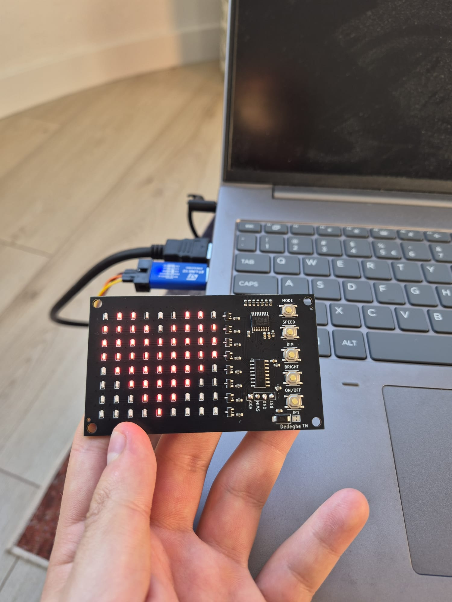
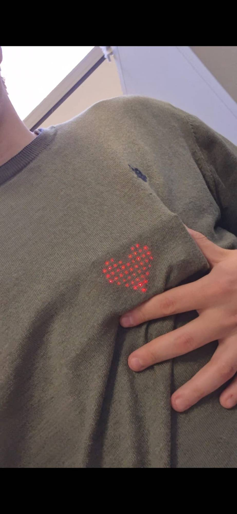
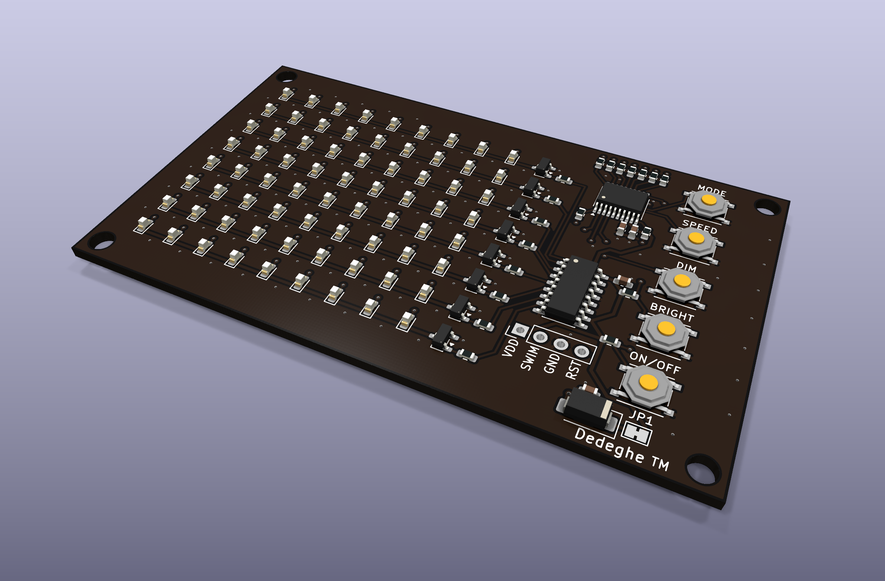
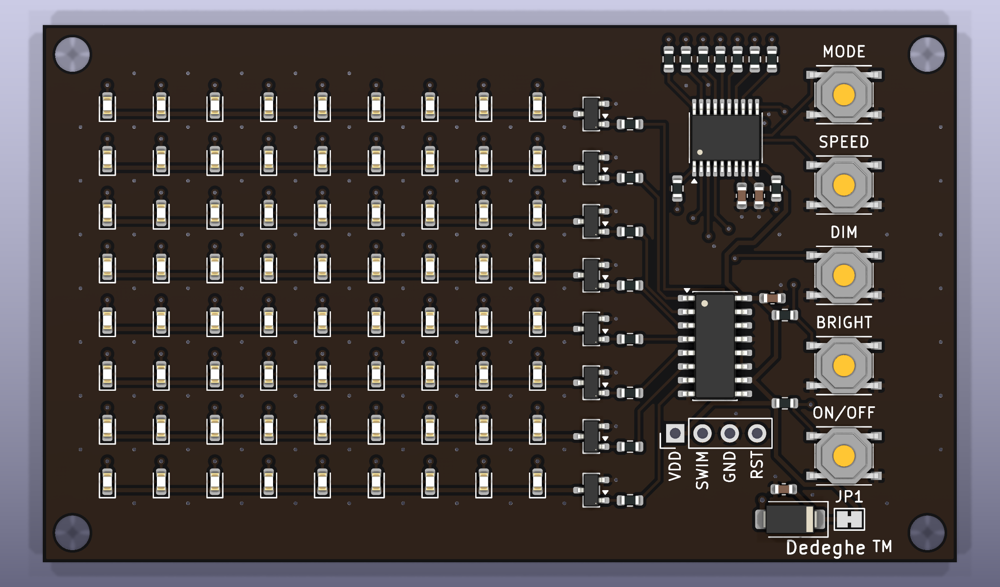
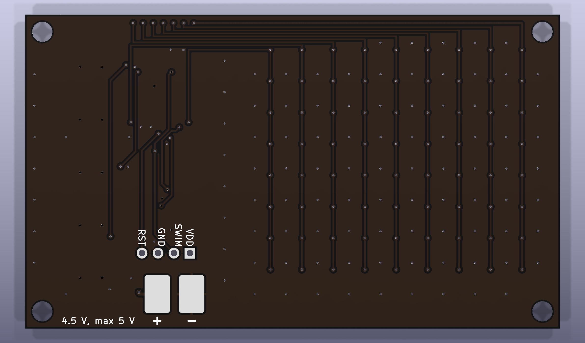

# LED Heart

A 9 x 8 matrix of 72 red LEDs on an 85 x 50 mm board, driven by an STM8S003
microcontroller and a 74HC595 shift register. It shows a beating heart,
animations and scrolling text, and runs from three AA or AAA cells. Five buttons
choose the mode, the speed and the brightness, and switch it on and off.

| The finished board | Worn under a shirt |
|---|---|
|  |  |

| Top | Bottom |
|---|---|
|  |  |

The renders show the black solder mask the boards were ordered with. KiCad has
no 3D model of the buttons, so the renders use a look-alike of about the same size.

## Status

- **Hardware:** designed, checked and ordered at JLCPCB in November 2026
  (5 boards, assembled by JLCPCB). Built and working: all 72 LEDs and the buttons
  pass the bring-up test.
- **Firmware:** a beating heart with speed, brightness, sleep and auto-off
  (`firmware/heart`), and a bring-up test (`firmware/test`). The test and the
  display, button and sleep code have run on the board.
- **Box:** a 3D-printable box for the board and a 3 x AA holder (`enclosure/`).

## Build your own

Everything needed is in this repository.

1. **Order the boards.** Upload the three files in `fabrication/` to JLCPCB
   (Gerber zip, BOM, placement file) and follow `fabrication/READ_ME_FIRST.txt`.
   JLCPCB solders every part on the top side.
2. **Battery holder.** A 3 x AA (or AAA) holder: red wire to the + pad, black to
   the - pad on the back. 3 x 1.5 V; never more than 5 V (no 4 cells, no 9 V).
3. **Programmer.** An ST-Link V2 clone (the small USB stick, about 2 to 10 euros).
   Not a "V2-1" and not an STLINK-V3MINI: those may lack SWIM.
4. **Compiler.** SDCC 4.x (https://sdcc.sourceforge.net). Double-click
   `firmware/heart/build.bat`; it writes `led_heart.hex`.
5. **Flash.** Wire the ST-Link to J1 by the names printed on both (3.3V, SWIM,
   GND, RST; never 5 V; no cells in). Then either:
   - ST Visual Programmer (free from st.com, installs the driver), steps in
     `firmware/test/README.md`; or
   - stm8flash (https://github.com/vdudouyt/stm8flash) with the WinUSB driver
     (installed with Zadig on "STM32 STLink"): put `stm8flash.exe` in
     `firmware/tools/` and run `firmware/flash.bat`. On Windows it has to be built
     from source; leaving out the ESP-STLink part makes it build with MSYS2 gcc.
   It is worth flashing `firmware/test` first: it lights every LED in turn and
   shows each button, so a bad joint shows at once.
6. **Box.** Print `enclosure/led_heart_box.stl` open side up, no supports, and
   screw the board on with four M3 x 8 to 10 mm screws.

## How it works

[Schematic (PDF)](led_heart.pdf)

- **LED matrix.** The anodes are joined by column (9 columns), the cathodes by
  row (8 rows). Each column is driven by a microcontroller pin through a 270 ohm
  resistor; each row is switched to ground by an S8050 NPN transistor. One row
  is lit at a time: about 6.5 mA peak and 0.8 mA average per LED at 4.5 V.
- **Row select.** The 74HC595's eight outputs drive the transistor bases through
  1 kohm resistors. Its two clock inputs are tied together, so it needs only two
  microcontroller pins.
- **Microcontroller.** STM8S003F3 (TSSOP-20), all 16 I/O pins in use. It is
  programmed over SWIM with an ST-Link V2 through four pads: VDD, SWIM, GND, RST.
- **Buttons.** MODE, SPEED, DIM, BRIGHT and ON/OFF. ON/OFF is on PB5, a pin that
  can wake the chip from halt: "off" is halt with every LED dark.
- **Power.** 4.5 V from three cells, soldered to two pads on the back. An SS14
  Schottky diode protects against reversed cells. There is no regulator: the
  STM8 runs from 2.95 to 5.5 V, so keep the supply at 5 V or less (a 5 V USB
  supply works). The copper jumper JP1 can be cut to add a hard power switch.

| Signal | STM8 pins |
|---|---|
| Columns 1 to 9 | PD3, PD2, PC7, PC6, PC5, PC4, PC3, PA3, PD4 |
| 74HC595 data, clock | PD5, PD6 |
| MODE, SPEED, DIM, BRIGHT, ON/OFF | PA1, PA2, PD1 (shared with SWIM), PB4, PB5 |

## Board

- 85 x 50 mm, 2 layers, 1.6 mm, all parts on the top side, four M3 mounting holes.
- 111 parts of 9 types, all Basic or Preferred parts at JLCPCB, so economic
  assembly adds no part fees.
- Rows run on the top layer, columns on the bottom layer with one via per LED;
  ground pour on both sides.
- Five boards, all assembled, cost about 22.50 dollars at JLCPCB (November 2026,
  before shipping and VAT).

## How it was made

The schematic, the board and the order files are generated by Python scripts in
`gen/`, run with KiCad 10's own Python (pcbnew). The LED matrix and the buses are
laid by rule; the area around the chips was routed with Freerouting.

Checks before ordering:

- ERC: 0 errors, 0 warnings.
- The exported netlist compared with the intended circuit: 0 differences.
- DRC with schematic parity: 0 violations, 0 unconnected, 0 differences.
- The circuit rebuilt from the Gerber files alone: 0 shorts, 0 opens, all 72
  LEDs the right way round.
- JLCPCB's placement preview compared with the board's pin-1 positions.

The full notes (decisions, circuit, checks, bring-up steps, firmware notes) are in
[docs/design-notes.md](docs/design-notes.md).

## Files

| Path | Contents |
|---|---|
| `led_heart.kicad_pro`, `.kicad_sch`, `.kicad_pcb` | KiCad 10 project |
| `led_heart.pdf` | schematic as PDF |
| `led_heart.net` | netlist the board script reads |
| `led_heart.pretty/` | footprints of the buttons and the battery pads |
| `parts.csv` | parts with LCSC numbers and prices |
| `fabrication/` | JLCPCB order files: Gerber zip, BOM, placement file, order settings |
| `gen/` | scripts for the schematic, the board, the order files and the renders |
| `preview/` | 3D renders |
| `photos/` | photos of the finished board |
| `enclosure/` | 3D-printable box (STL, 89.6 x 54.6 x 25.1 mm): the board sits in a pocket flush with the rim, screwed onto four slim corner posts with M3 x 8 to 10 mm screws; the 3 x AA holder glued to its back rests on the floor; made by `gen/led_box.py` |
| `firmware/` | `heart/` beating heart, `test/` bring-up test (both C for SDCC), `flash.bat` for stm8flash |
| `docs/design-notes.md` | design notes |

## Rebuilding

Run the scripts in `gen/` with KiCad 10's Python while KiCad is closed. The paths
to KiCad and Freerouting 2.1.0 are set at the top of `gen/led_board.py`,
`gen/kisch.py`, `gen/frhelp.py` and `gen/build_board.sh`.

1. `led_sch.py`: schematic, ERC, netlist and PDF; `led_check.py` compares the netlist with the circuit.
2. `build_board.sh` (in Git Bash): places, routes and checks the board. Freerouting
   gives a different but equally valid routing of the chip area on every run.
3. `led_fab.py`: Gerber zip, BOM and placement file for JLCPCB, with each part's
   angle worked out from JLCPCB's own footprint.
4. `led_render.py`: the renders in `preview/`.

To order, upload the three files in `fabrication/` to JLCPCB and follow
`fabrication/READ_ME_FIRST.txt`.

## Firmware

C built with SDCC, flashed over SWIM with an ST-Link. A timer interrupt at 16 kHz
scans the rows (125 frames per second) and sets the brightness by how long each
row stays on. Speed and brightness are saved in EEPROM. ON/OFF puts the chip in
halt with the LEDs off (about 10 uA) and wakes it. The MODE button is left free
for your own animations; `firmware/heart/README.md` says how.

## License

MIT licensed, see [LICENSE](LICENSE). `gen/kisch.py` and `gen/frhelp.py` come
from my QFH receiver project.

Edy Grigore
